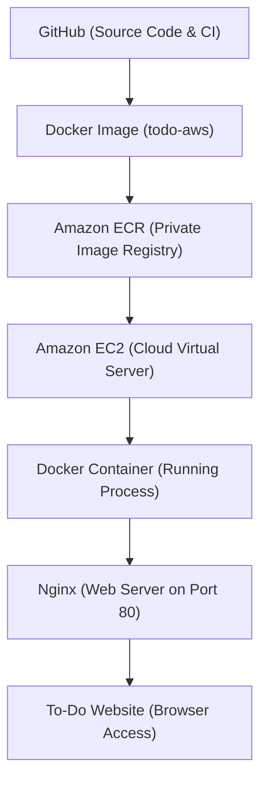

# Containerized Microservice on AWS - To-Do List Application

## 1. Project Title
**Containerized To-Do List Web App on AWS**  
*College Cloud Assessment Project 1: "Containerized microservice on AWS"*

---

## 2. What the Project Does
This project is a clean, responsive **To-Do List** web application built using fundamental web technologies (HTML, CSS, and Vanilla JavaScript). It runs locally in the browser with `localStorage` so tasks remain saved even after refreshing the page.

To fulfill the cloud assessment:
- The website is **containerized** using **Docker** with a lightweight **Nginx** web server.
- The project includes a **GitHub Actions CI workflow** that verifies the presence of required files and validates that the Docker image builds successfully.
- The architecture is prepared for **Amazon Web Services (AWS)** using **Amazon ECR** (Elastic Container Registry) to store the container image and **Amazon EC2** (Elastic Compute Cloud) to run the container in the cloud.

---

## 3. Project Structure
```text
cloud-assessment/
│
├── index.html                  # Structure of the To-Do webpage
├── style.css                   # Clean, modern visual styling
├── script.js                   # Interactivity, task logic, and localStorage
├── Dockerfile                  # Instructions to package the app with Nginx
├── .dockerignore               # Files excluded from the Docker build context
├── README.md                   # Beginner-friendly guide and documentation
└── .github/
    └── workflows/
        └── ci.yml              # GitHub Actions CI workflow (checks files & builds image)
```

---

## 4. Key Concepts Explained for Beginners

### What is Docker?
**Docker** is a tool that packages an application and everything it needs to run (code, web server, runtime libraries, and configuration) into a single, standardized unit. Docker ensures that the phrase *"It works on my machine!"* becomes *"It works on any machine!"*, whether on your laptop or on an AWS virtual machine.

### What is a Docker Image?
A **Docker Image** is a read-only blueprint, template, or snapshot. It contains all the instructions and files needed to create a running environment. You can think of a Docker image like a recipe or a class in programming.

### What is a Docker Container?
A **Docker Container** is a running instance of a Docker image. If the Docker image is the recipe, the container is the actual cake baked from that recipe. You can run multiple containers from a single image.

### What is Nginx?
**Nginx** is a high-performance, lightweight web server. In this project, Nginx runs inside the Docker container, listens on port `80`, and serves `index.html`, `style.css`, and `script.js` whenever a user opens the website.

### What is Amazon ECR (Elastic Container Registry)?
**Amazon ECR** is a fully managed, private Docker container registry provided by AWS. 
- Think of **GitHub** as the place where you store and share your **source code**.
- Think of **Amazon ECR** as the place where you store and share your **built Docker images**.

### What is Amazon EC2 (Elastic Compute Cloud)?
**Amazon EC2** is a virtual server (virtual machine) in the cloud provided by AWS. We run an EC2 instance, install Docker on it, download our Docker image from ECR, and run our container so that anyone on the internet can access the To-Do website.

---

## 5. Architecture Diagram



### Flow Breakdown:
1. **GitHub**: Stores the project files (`index.html`, `style.css`, `script.js`, `Dockerfile`) and runs GitHub Actions CI.
2. **Docker Image**: The packaged application containing our web files and the Nginx web server.
3. **Amazon ECR**: Our AWS cloud repository where our Docker image is stored.
4. **Amazon EC2**: The virtual cloud machine on AWS running Amazon Linux.
5. **Docker Container**: EC2 pulls the image from ECR and executes it as a container.
6. **Nginx**: Inside the container, Nginx listens for HTTP requests on port 80.
7. **To-Do Website**: Users access the website by visiting the EC2 Public IP address in any browser.

---

## 6. How the Application Works (Features)
- **Add Task**: Type into the input field and click **"Add Task"** (or press the **Enter** key).
- **Mark Complete**: Click on any task text to toggle its completion status (strikethrough styling).
- **Delete Task**: Click the red **"Delete"** button next to any task to remove it.
- **Task Counter**: Dynamically counts and displays how many pending tasks remain.
- **Clear All**: One-click button to clear all tasks with confirmation.
- **Local Storage**: Uses the browser's built-in `localStorage` API so tasks remain saved even if you refresh or reopen the browser.

---

## 7. How to Run Locally

### Method A: Direct in Browser (Simplest)
You do not need any tools installed to test the web app directly. Simply double-click `index.html` to open it in Google Chrome, Microsoft Edge, or Mozilla Firefox.

### Method B: With Docker (Recommended)

#### Step 1: Build the Docker Image
```bash
docker build -t todo-aws .
```
- `-t todo-aws`: Tags (names) the image `todo-aws`.
- `.`: Tells Docker to use the current directory where the `Dockerfile` is located.

#### Step 2: Run the Docker Container
```bash
docker run -d -p 8080:80 --name todo-app todo-aws
```
- `-d`: Runs the container in the background (detached mode).
- `-p 8080:80`: Forwards port `8080` on your computer to port `80` inside the container.
- `--name todo-app`: Gives your container a friendly name.
- `todo-aws`: Specifies the image name to run.

#### Step 3: View the Website
Open your browser and navigate to:
```text
http://localhost:8080
```

#### Step 4: Stop and Remove the Container
When you are done testing:
```bash
docker stop todo-app
docker rm todo-app
```

---

## 8. GitHub Actions CI (Continuous Integration)
The file `.github/workflows/ci.yml` is configured to run automatically whenever you push to the `main` branch.

### What it does:
1. Checks out your code on an Ubuntu virtual runner.
2. **Basic Assessment Test**:
   - Verifies that `index.html` exists.
   - Verifies that `style.css` exists.
   - Verifies that `script.js` exists.
3. **Builds the Docker Image**:
   - Executes `docker build -t todo-aws .` to confirm that the Dockerfile is valid and builds with zero errors.

> [!NOTE]
> Per assessment specifications, automatic deployment to AWS is **not** included in the CI workflow at this stage. Deployment steps to AWS are executed manually and safely when you are ready.

---

## 9. How to Push the Docker Image to Amazon ECR

When you are ready to upload your Docker image to AWS ECR, follow these steps using the AWS CLI:

### Step 1: Create an ECR Repository
1. Log in to the [AWS Management Console](https://console.aws.amazon.com/).
2. Navigate to **Elastic Container Registry (ECR)**.
3. Click **Create repository**.
4. Set repository visibility to **Private**.
5. Set Repository name to: `todo-aws`.
6. Click **Create repository**.
7. Note down your ECR Repository URI (for example: `123456789012.dkr.ecr.us-east-1.amazonaws.com/todo-aws`).

### Step 2: Authenticate Docker to your Amazon ECR Registry
In your terminal (replace `123456789012` and `us-east-1` with your AWS Account ID and Region):
```bash
aws ecr get-login-password --region us-east-1 | docker login --username AWS --password-stdin 123456789012.dkr.ecr.us-east-1.amazonaws.com
```

### Step 3: Tag your Local Docker Image for ECR
```bash
docker tag todo-aws:latest 123456789012.dkr.ecr.us-east-1.amazonaws.com/todo-aws:latest
```

### Step 4: Push the Image to ECR
```bash
docker push 123456789012.dkr.ecr.us-east-1.amazonaws.com/todo-aws:latest
```

---

## 10. How to Deploy the Container on Amazon EC2

### Step 1: Launch an EC2 Instance
1. Go to **EC2 Console** -> Click **Launch instance**.
2. **Name**: `todo-ec2-server`.
3. **AMI**: **Amazon Linux 2023** (Free tier eligible).
4. **Instance type**: `t2.micro` or `t3.micro` (Free tier eligible).
5. **Key pair**: Create or select an existing `.pem` key pair.
6. **Network / Security Group**:
   - Enable **Allow SSH traffic** (Port 22).
   - Enable **Allow HTTP traffic from the internet** (Port 80).
7. Click **Launch instance**.

### Step 2: Attach IAM Role for ECR Read Access
1. In the AWS Console, go to **IAM** -> **Roles** -> **Create role**.
2. Select **AWS service** -> **EC2** -> Click **Next**.
3. Attach policy: `AmazonEC2ContainerRegistryReadOnly`.
4. Name the role: `EC2-ECR-ReadOnly-Role` and save.
5. In **EC2 Instances**, select your instance -> **Actions** -> **Security** -> **Modify IAM role**.
6. Select `EC2-ECR-ReadOnly-Role` and click **Update IAM role**.

### Step 3: Connect to EC2 and Run the Container
Connect to your EC2 instance via **EC2 Instance Connect** in the AWS console, and run:

```bash
# 1. Update packages
sudo dnf update -y

# 2. Install Docker
sudo dnf install docker -y

# 3. Start Docker service
sudo systemctl start docker
sudo systemctl enable docker

# 4. Allow the ec2-user to run Docker without sudo
sudo usermod -a -G docker ec2-user
newgrp docker

# 5. Log in to your private Amazon ECR repository
aws ecr get-login-password --region us-east-1 | docker login --username AWS --password-stdin 123456789012.dkr.ecr.us-east-1.amazonaws.com

# 6. Pull your Docker image from ECR
docker pull 123456789012.dkr.ecr.us-east-1.amazonaws.com/todo-aws:latest

# 7. Run the container on port 80
docker run -d -p 80:80 --name todo-app 123456789012.dkr.ecr.us-east-1.amazonaws.com/todo-aws:latest
```

### Step 4: Access the Website
Open your browser and visit:
```text
http://<YOUR-EC2-PUBLIC-IP>
```
Your containerized To-Do web app is now running live on AWS!

---

## 11. Basic Troubleshooting

- **Website does not open in browser using EC2 Public IP**:
  - Verify your EC2 **Security Group** has an inbound rule permitting **HTTP** on **Port 80** with source `0.0.0.0/0`.
  - Ensure you are using `http://` and NOT `https://` in the browser URL bar.
- **Docker command not recognized on EC2**:
  - Run `sudo dnf install docker -y` and `sudo systemctl start docker`.
- **Permission denied when running Docker on EC2**:
  - Run `sudo usermod -a -G docker ec2-user` followed by `newgrp docker`.
- **ECR login error ("denied: Your authorization token has expired")**:
  - Re-run the `aws ecr get-login-password` command to generate a fresh authentication token (tokens are valid for 12 hours).
- **Port 8080 already in use locally**:
  - Run `docker ps` to see if a container is already running.
  - Stop the old container with `docker stop <container-id>` or change the port mapping (e.g., `-p 8081:80`).
